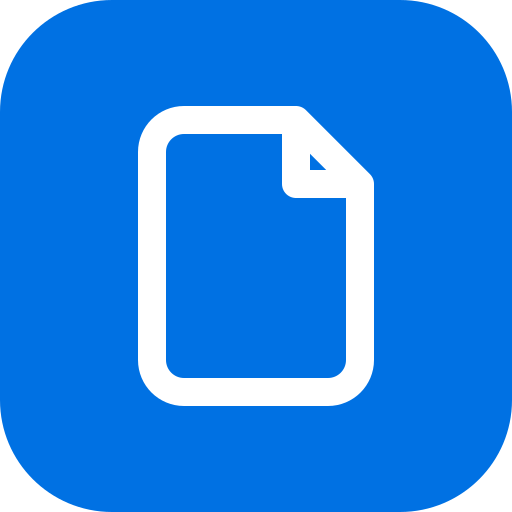

<p align="center">
  
</p>

<h1 align="center">Docs</h1>

<p align="center">
  Eine aufgeräumte, moderne Oberfläche für dein <a href="https://github.com/paperless-ngx/paperless-ngx">Paperless-ngx</a> – für Handy und Desktop.<br>
  <a href="README.md">English</a> · <b>Deutsch</b>
</p>

<p align="center">
  <a href="https://robinvonmises.github.io/paperless-docs/"><b>➜ Docs öffnen</b></a>
</p>

---

Docs ist eine andere Oberfläche für das Paperless-ngx, das du schon betreibst. Die App spricht Deutsch und Englisch und richtet sich nach der Sprache deines Browsers (umstellbar unter *Einstellungen → Sprache*). Paperless macht
im Hintergrund weiter die ganze Arbeit (Texterkennung, Workflows, Mail, Consume-Ordner, Berechtigungen).
Docs macht nur das Alltägliche – finden, sortieren, ablegen – schneller und schöner.

Es gibt **zwei Wege**:

| | **Gehostete Version nutzen** | **Selbst hosten** |
|---|---|---|
| Was du brauchst | Dein Paperless per HTTPS erreichbar | Einen Docker-Host |
| Aufwand | 2 Minuten, eine Einstellung in Paperless | Ein Container im Stack |
| Adresse | `https://robinvonmises.github.io/paperless-docs/` | deine eigene, z. B. `docs.example.com` |
| Anleitung | [unten](#mit-deinem-eigenen-paperless-nutzen-in-5-schritten) | [Selbst hosten](#selbst-hosten) |

## Inhalt

- [Mit deinem eigenen Paperless nutzen – in 5 Schritten](#mit-deinem-eigenen-paperless-nutzen-in-5-schritten)
- [Wenn etwas nicht klappt](#wenn-etwas-nicht-klappt)
- [Datenschutz und Sicherheit](#datenschutz-und-sicherheit)
- [Funktionen](#funktionen)
- [Selbst hosten](#selbst-hosten)
- [Entwicklung](#entwicklung)

---

## Mit deinem eigenen Paperless nutzen in 5 Schritten

Du musst nichts installieren. Du sagst deinem Paperless nur einmal, dass es mit Docs reden darf.

### Bevor du anfängst

- Du betreibst **Paperless-ngx** (aktuelle 2.x-Version) mit Docker Compose.
- Dein Paperless ist von dem Gerät, auf dem du Docs nutzen willst, mit **https://** erreichbar
  (aus dem Internet oder über dein VPN).
- Du kennst deine Paperless-Adresse, z. B. `paperless.example.com`, und deinen Benutzernamen und dein Passwort.

### Schritt 1 – Compose-Datei von Paperless öffnen

Geh auf deinem Server in den Ordner, in dem dein Paperless läuft, und öffne `docker-compose.yml`
(manchmal heißt sie `compose.yaml`).

Du siehst mehrere Dienste, zum Beispiel `broker`, `db` und `webserver`.
**`webserver` ist Paperless selbst** – um den geht es.

### Schritt 2 – Docs erlauben

Füge beim Dienst **`webserver`** unter `environment:` diese Zeile hinzu:

```yaml
  webserver:
    # ... alles andere bleibt, wie es ist
    environment:
      PAPERLESS_CORS_ALLOWED_HOSTS: https://robinvonmises.github.io
```

**Dein `webserver` hat kein `environment:`, sondern `env_file: docker-compose.env`?**
Dann kommt die Zeile stattdessen in die Datei `docker-compose.env` (ohne Leerzeichen, ohne Anführungszeichen):

```
PAPERLESS_CORS_ALLOWED_HOSTS=https://robinvonmises.github.io
```

**Es gibt schon eine Zeile `PAPERLESS_CORS_ALLOWED_HOSTS`?** Dann Docs mit Komma anhängen:
`PAPERLESS_CORS_ALLOWED_HOSTS=https://etwas.anderes,https://robinvonmises.github.io`

> Warum? Dein Browser lässt eine Webseite nur dann mit deinem Paperless sprechen, wenn Paperless
> das ausdrücklich erlaubt („CORS“). Diese Zeile erlaubt genau diese eine Seite – ohne dein Passwort kommt trotzdem niemand rein.

### Schritt 3 – Paperless neu starten

Im selben Ordner ausführen:

```bash
docker compose up -d
```

(`docker compose restart` reicht **nicht** – dabei wird die neue Einstellung nicht übernommen.)

Prüfen, ob es geklappt hat:

```bash
docker compose exec webserver env | grep CORS
```

Ausgegeben werden sollte `PAPERLESS_CORS_ALLOWED_HOSTS=https://robinvonmises.github.io`.

### Schritt 4 – Anmelden

1. **https://robinvonmises.github.io/paperless-docs/** öffnen
2. **Paperless-Adresse:** deine Adresse, z. B. `paperless.example.com`
3. **Benutzername** und **Passwort:** dieselben wie in der normalen Paperless-Oberfläche
4. Auf **Anmelden** tippen

Fertig. 🎉

### Schritt 5 – Auf den Home-Bildschirm legen (optional)

- **iPhone / iPad:** in Safari auf *Teilen* → *Zum Home-Bildschirm*.
- **Android:** in Chrome auf *⋮* → *Zum Startbildschirm hinzufügen* / *App installieren*.
- **Desktop (Chrome / Edge):** auf das Installieren-Symbol in der Adressleiste klicken.

Docs öffnet sich dann wie eine normale App, ohne Browserleiste.

---

## Wenn etwas nicht klappt

| Was du siehst | Was es bedeutet | Was du tun kannst |
|---|---|---|
| *„Keine Verbindung zu … PAPERLESS_CORS_ALLOWED_HOSTS=…“* | Dein Paperless erlaubt Docs noch nicht, oder die Adresse stimmt nicht | Adresse prüfen. Schritt 2 und 3 nochmal, mit **`docker compose up -d`**, und mit dem `grep CORS`-Befehl prüfen. |
| *„… darf deshalb keine HTTP-Adresse ansprechen“* | Dein Paperless läuft nur mit `http://` | Docs braucht `https://`. Paperless hinter einen Reverse Proxy mit SSL stellen (z. B. Nginx Proxy Manager, Caddy, Traefik) – oder [Docs selbst hosten](#selbst-hosten), im eigenen Netz. |
| *„Benutzername oder Passwort falsch“* | Falsche Anmeldedaten | Dieselben Daten wie in der Paperless-Weboberfläche verwenden. |
| Zu Hause geht's, unterwegs nicht | Paperless ist nur im Heimnetz erreichbar | Über dein VPN verbinden oder Docs im eigenen Netz selbst hosten. |
| Weniger Dokumente als erwartet | Docs zeigt genau das, was **dein** Paperless-Benutzer sehen darf | Berechtigungen/Besitzer in Paperless prüfen. |

---

## Datenschutz und Sicherheit

Docs ist eine reine Browser-App: nur HTML, CSS und JavaScript. **Es gibt keinen Docs-Server und keine Docs-Datenbank.**

| Was | Wohin es geht / wo es liegt |
|---|---|
| Dein **Passwort** | Wird **einmal und direkt** von deinem Browser an **dein** Paperless geschickt, um einen Anmelde-Token zu holen. Gespeichert wird es nirgends. |
| **Anmelde-Token** | Nur im Browser auf deinem Gerät (wenn „Angemeldet bleiben“ an ist). |
| **Paperless-Adresse**, Merkliste, Ansichten | Nur im Browser auf deinem Gerät. |
| **Deine Dokumente** | Gehen direkt von deinem Paperless an deinen Browser. Nie über GitHub. |
| **GitHub** | Liefert nur die App-Dateien aus – wie bei jeder Webseite. Sieht, dass die Seite aufgerufen wurde, sonst nichts. |

Gut zu wissen:

- **Der Code ist der Vertrauensanker.** Die gehostete Version wird genau aus dem Code in diesem Repository gebaut.
  Wer dem nicht vertrauen will, [hostet selbst](#selbst-hosten) – es ist dieselbe App.
- **Der Token ist wie ein Schlüssel und läuft nicht ab.** „Abmelden“ löscht ihn vom Gerät.
  Geht ein Gerät verloren, in Paperless unter *Profil* einen neuen API-Token erzeugen – der alte ist dann wertlos.
- **Die CORS-Zeile erlaubt nur dieser einen Seite**, mit deinem Paperless zu sprechen. Sie öffnet
  Paperless für niemanden; anmelden muss man sich trotzdem.
- Strenge Content-Security-Policy: keine fremden Skripte, keine Inline-Skripte, kein Tracking, keine Statistik.
  Alles, was aus Paperless kommt (auch Treffer der Volltextsuche), wird vor der Anzeige entschärft.

---

## Funktionen

- **Übersicht** – Begrüßung, Kennzahlen, Posteingang-Hinweis, deine Bereiche (Tags) als Kacheln, Merkliste, zuletzt angesehen, häufigste Korrespondenten
- **Ein Dokument-Browser für alles** – jeder Tag, Korrespondent, Dokumenttyp, Speicherpfad und die Volltextsuche nutzen dieselbe Ansicht:
  - Suche innerhalb der Liste, Sortierung (neueste, älteste, zuletzt hinzugefügt, Titel, Korrespondent, Relevanz)
  - Filter für Tags, Korrespondent, Typ, Speicherpfad, Jahr, Posteingang – als entfernbare Chips
  - **vier Ansichten:** Liste (nach Jahren), Kacheln mit großen Vorschauen, Zeitleiste nach Monaten, Tabelle mit sortierbaren Spalten (Desktop)
  - endloses Scrollen; jede Ansicht hat eine eigene Adresse zum Speichern
- **Mehrfachauswahl** – Tags hinzufügen/entfernen, Typ oder Korrespondent setzen, als ZIP laden, löschen (in den Papierkorb von Paperless)
- **Schnellsuche** – <kbd>⌘K</kbd> / <kbd>Strg K</kbd> für Dokumente, Tags, Korrespondenten und Befehle
- **Posteingang** – ein Dokument nach dem anderen, Vorschläge von Paperless vorausgefüllt, mit einem Klick übernehmen
- **Dokumentansicht** – Vorschau, Details, Notizen, ähnliche Dokumente, Tags schnell ändern, mit <kbd>←</kbd> <kbd>→</kbd> durch die Liste blättern
- **Hochladen / Scannen** – Drag & Drop am Desktop, Kamera am Handy, Verarbeitungsstatus live
- **Durchstöbern** – alle Tags, Korrespondenten, Typen und Speicherpfade als Karten mit Anzahl
- **Einstellungen** – hell / dunkel / automatisch, Sprache (Deutsch / Englisch), Standardansicht, Bereiche und Farben wählen
- **Tastenkürzel** – in der App <kbd>?</kbd> drücken

---

## Selbst hosten

Das Docker-Image wird automatisch gebaut: `ghcr.io/robinvonmises/paperless-docs:latest` (amd64 + arm64).
Es ist ein kleiner nginx-Container, der die App ausliefert. Er hat zwei Betriebsarten:

| | **Feste Instanz** | **Adresse bei der Anmeldung** |
|---|---|---|
| Einstellung | `PAPERLESS_UPSTREAM` gesetzt | `PAPERLESS_UPSTREAM` leer |
| Weg der Daten | Browser → Docs-Container → Paperless | Browser → Paperless direkt (wie die gehostete Version) |
| CORS in Paperless | **nicht nötig** | nötig (mit deiner Docs-Adresse) |
| Gut für | dein eigenes Paperless, auch mit `http://` oder nur im Heimnetz | ein Docs für mehrere Paperless-Instanzen |

### Feste Instanz (empfohlen beim Selbsthosten)

```yaml
services:
  docs:
    image: ghcr.io/robinvonmises/paperless-docs:latest
    restart: unless-stopped
    ports:
      - "8090:80"
    environment:
      PAPERLESS_UPSTREAM: https://paperless.example.com
      # optional, siehe Tabelle unten:
      # DOCS_AREAS: "Haus:#A2845E,Bank:#FF9500,Steuer:#FF3B30"
```

Im selben Compose-Netz geht auch die interne Adresse:
`PAPERLESS_UPSTREAM: http://webserver:8000`, dazu `PAPERLESS_HOST: paperless.example.com`
(muss in `PAPERLESS_URL` / `PAPERLESS_ALLOWED_HOSTS` erlaubt sein) und
`PAPERLESS_PUBLIC_URL: https://paperless.example.com`.

Dann im Reverse Proxy einen Host darauf zeigen lassen, z. B. `docs.example.com` → `<docker-host>:8090`, mit SSL.

### Adresse bei der Anmeldung

```yaml
services:
  docs:
    image: ghcr.io/robinvonmises/paperless-docs:latest
    restart: unless-stopped
    ports:
      - "8090:80"
```

Jedes Paperless, das damit genutzt werden soll, braucht
`PAPERLESS_CORS_ALLOWED_HOSTS=https://docs.example.com` (deine Docs-Adresse).

### Umgebungsvariablen

| Variable | Bedeutung |
|---|---|
| `PAPERLESS_UPSTREAM` | Paperless, an das `/api/` weitergeleitet wird. Leer = Adresse wird bei der Anmeldung angegeben |
| `PAPERLESS_HOST` | Host-Header für Paperless. Standard: der Host aus `PAPERLESS_UPSTREAM` |
| `PAPERLESS_PUBLIC_URL` | Link „Klassische Paperless-Oberfläche“. Standard: `PAPERLESS_UPSTREAM`, wenn https |
| `DOCS_NAME` | App-Name (Standard „Docs“) |
| `DOCS_AREAS` | Bereiche auf der Übersicht: `Tag:#Farbe,Tag:#Farbe`. Leer = deine 8 häufigsten Tags |
| `DOCS_ALLOWED_SERVERS` | Nur „Adresse bei der Anmeldung“: erlaubte Paperless-Adressen (mit Leerzeichen getrennt). Leer = alle |

Bereiche und Farben kann außerdem jeder in der App unter *Einstellungen* ändern – das gilt dann für diesen Browser.

### Eigene Kopie auf GitHub Pages

Docs ist komplett statisch, jeder Webserver kann den Ordner `web/` ausliefern. Eigene Kopie auf GitHub Pages:

1. Dieses Repository forken.
2. Im Fork: **Settings → Pages → Build and deployment → Source: GitHub Actions**.
3. Den Workflow *GitHub Pages* einmal starten (Reiter Actions) oder eine Änderung pushen.
4. In Paperless: `PAPERLESS_CORS_ALLOWED_HOSTS=https://<dein-benutzername>.github.io`

Tipp: Mit einer eigenen Domain (Settings → Pages → Custom domain) bekommt Docs eine eigene Adresse und teilt
den Browser-Speicher nicht mit anderen GitHub-Pages-Seiten desselben Kontos.

---

## Entwicklung

Kein Build-Schritt. `web/` enthält reines HTML, CSS und JavaScript.

```bash
docker build -t docs .
docker run --rm -p 8090:80 -e PAPERLESS_UPSTREAM=https://paperless.example.com docs   # feste Instanz
docker run --rm -p 8090:80 docs                                                     # Adresse bei der Anmeldung
```

Oder `web/` mit einem beliebigen statischen Webserver ausliefern und mit der Adresse eines Paperless anmelden, das diese Herkunft per CORS erlaubt.
