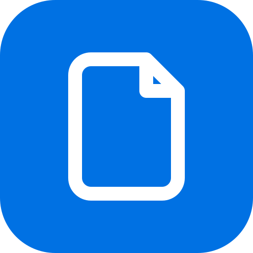

<p align="center">
  
</p>

<h1 align="center">Docs</h1>

<p align="center">
  A clean, modern interface for your <a href="https://github.com/paperless-ngx/paperless-ngx">Paperless-ngx</a> – for phone and desktop.<br>
  <b>English</b> · <a href="README.de.md">Deutsch</a>
</p>

<p align="center">
  <a href="https://robinvonmises.github.io/paperless-docs/"><b>➜ Open Docs</b></a>
</p>

---

Docs is a different front end for the Paperless-ngx you already run. Paperless keeps doing
all the work in the background (OCR, workflows, mail, consume folder, permissions).
Docs just makes the everyday things – finding, sorting, filing – faster and nicer.

There are **two ways** to use it:

| | **Use the hosted version** | **Host it yourself** |
|---|---|---|
| What you need | Your Paperless reachable via HTTPS | A Docker host |
| Effort | 2 minutes, one setting in Paperless | A container in your stack |
| Address | `https://robinvonmises.github.io/paperless-docs/` | your own, e.g. `docs.example.com` |
| Guide | [below](#use-it-with-your-own-paperless-in-5-steps) | [self-hosting](#self-hosting) |

> The app speaks **English and German** – it follows your browser language, and you can switch it under *Settings → Language*.

## Contents

- [Use it with your own Paperless in 5 steps](#use-it-with-your-own-paperless-in-5-steps)
- [Troubleshooting](#troubleshooting)
- [Privacy and security](#privacy-and-security)
- [Features](#features)
- [Self-hosting](#self-hosting)
- [Development](#development)

---

## Use it with your own Paperless in 5 steps

You don't need to install anything. You only tell your Paperless once that it may talk to Docs.

### Before you start

- You run **Paperless-ngx** (a current 2.x version) with Docker Compose.
- Your Paperless is reachable with **https://** from the device you want to use Docs on
  (from the internet, or through your VPN).
- You know your Paperless address, e.g. `paperless.example.com`, and your username and password.

### Step 1 – Open your Paperless compose file

On your server, go to the folder where your Paperless runs and open `docker-compose.yml`
(sometimes called `compose.yaml`).

You will see several services, for example `broker`, `db` and `webserver`.
**`webserver` is Paperless itself** – that's the one you need.

### Step 2 – Allow Docs

Add this line to the `environment:` section of the **`webserver`** service:

```yaml
  webserver:
    # ... leave everything else as it is
    environment:
      PAPERLESS_CORS_ALLOWED_HOSTS: https://robinvonmises.github.io
```

**Your `webserver` has no `environment:` but `env_file: docker-compose.env`?**
Then add this line to the file `docker-compose.env` instead (no spaces, no quotes):

```
PAPERLESS_CORS_ALLOWED_HOSTS=https://robinvonmises.github.io
```

**You already have a `PAPERLESS_CORS_ALLOWED_HOSTS` line?** Add Docs with a comma:
`PAPERLESS_CORS_ALLOWED_HOSTS=https://something.else,https://robinvonmises.github.io`

> Why? Your browser only lets a web page talk to your Paperless if Paperless explicitly allows it
> ("CORS"). This line allows exactly this one page – nobody gets access without your password.

### Step 3 – Restart Paperless

In the same folder, run:

```bash
docker compose up -d
```

(`docker compose restart` is **not** enough – it doesn't pick up the new setting.)

Check that it worked:

```bash
docker compose exec webserver env | grep CORS
```

You should see `PAPERLESS_CORS_ALLOWED_HOSTS=https://robinvonmises.github.io`.

### Step 4 – Sign in

1. Open **https://robinvonmises.github.io/paperless-docs/**
2. **Paperless address**: your address, e.g. `paperless.example.com`
3. **Username** / **Password**: your normal Paperless username and password
4. Tap **Sign in**

Done. 🎉

### Step 5 – Put it on your home screen (optional)

- **iPhone / iPad:** in Safari tap *Share* → *Add to Home Screen*.
- **Android:** in Chrome tap *⋮* → *Add to Home screen* / *Install app*.
- **Desktop (Chrome / Edge):** click the install icon in the address bar.

Docs then opens like a normal app, without the browser bar.

---

## Troubleshooting

| What you see | What it means | What to do |
|---|---|---|
| *“Could not connect to … PAPERLESS_CORS_ALLOWED_HOSTS=…”* | Your Paperless doesn't allow Docs yet, or the address is wrong | Check the address. Do steps 2 and 3 again, use **`docker compose up -d`** and check with the `grep CORS` command. |
| *“… cannot connect to an HTTP address”* | Your Paperless only runs on `http://` | Docs needs `https://`. Put Paperless behind a reverse proxy with SSL (e.g. Nginx Proxy Manager, Caddy, Traefik) – or [host Docs yourself](#self-hosting) in your network. |
| *“Wrong username or password”* | Wrong login | Use the same login as in the Paperless web interface. |
| Works at home, not on the go | Paperless is only reachable in your home network | Connect through your VPN, or self-host Docs inside your network. |
| You see fewer documents than expected | Docs shows exactly what **your** Paperless user is allowed to see | Check permissions/owner in Paperless. |

---

## Privacy and security

Docs is a pure browser app: just HTML, CSS and JavaScript. **There is no Docs server and no Docs database.**

| What | Where it goes / is stored |
|---|---|
| Your **password** | Sent **once, directly** from your browser to **your** Paperless to get a login token. Stored nowhere. |
| **Login token** | Only in your browser on your device (if "Stay signed in" is on). |
| **Paperless address**, favourites, view settings | Only in your browser on your device. |
| **Your documents** | Go directly from your Paperless to your browser. Never through GitHub. |
| **GitHub** | Only delivers the app files – like any website. It sees that the page was loaded, nothing else. |

Good to know:

- **The code is the trust anchor.** The hosted version is built from exactly the code in this repository.
  If you'd rather not trust that, [host it yourself](#self-hosting) – it's the same app.
- **The token is like a key and doesn't expire.** "Sign out" removes it from the device.
  If you lose a device, create a new API token in Paperless under *Profile* – the old one stops working.
- **The CORS line only allows this one page** to talk to your Paperless. It does not open Paperless
  to anyone; a login is still required.
- Strict Content Security Policy: no external scripts, no inline scripts, no trackers, no analytics.
  Everything coming from Paperless (including search highlights) is escaped before it's shown.

---

## Features

- **Overview** – greeting, quick stats, inbox notice, your areas (tags) as tiles, favourites, recently viewed, top correspondents
- **One document browser for everything** – every tag, correspondent, document type, storage path and the full-text search use the same view:
  - search within the list, sort (newest, oldest, recently added, title, correspondent, relevance)
  - filters for tags, correspondent, type, storage path, year, inbox – shown as removable chips
  - **four views:** list (grouped by year), tiles with large previews, timeline by month, table with sortable columns (desktop)
  - infinite scrolling; the address of every view can be bookmarked
- **Multi-select** – add/remove tags, set type or correspondent, download as ZIP, delete (to the Paperless trash)
- **Quick search** – <kbd>⌘K</kbd> / <kbd>Ctrl K</kbd> for documents, tags, correspondents and commands
- **Inbox** – one document at a time, Paperless suggestions pre-filled, accept with one click
- **Document view** – preview, details, notes, similar documents, quick tag editing, flip through the list with <kbd>←</kbd> <kbd>→</kbd>
- **Upload / scan** – drag & drop on desktop, camera on the phone, live processing status
- **Browse** – all tags, correspondents, types and storage paths as cards with counts
- **Settings** – light / dark / automatic, language (English / German), default view, choose your areas and colours
- **Keyboard shortcuts** – press <kbd>?</kbd> in the app

---

## Self-hosting

The Docker image is built automatically: `ghcr.io/robinvonmises/paperless-docs:latest` (amd64 + arm64).
It's a small nginx container that serves the app. It has two modes:

| | **Fixed instance** | **Address at sign-in** |
|---|---|---|
| Setting | `PAPERLESS_UPSTREAM` set | `PAPERLESS_UPSTREAM` empty |
| Data path | Browser → Docs container → Paperless | Browser → Paperless directly (like the hosted version) |
| CORS in Paperless | **not needed** | needed (with your Docs address) |
| Good for | your own Paperless, also `http://` or LAN-only | one Docs for several Paperless instances |

### Fixed instance (recommended for self-hosting)

```yaml
services:
  docs:
    image: ghcr.io/robinvonmises/paperless-docs:latest
    restart: unless-stopped
    ports:
      - "8090:80"
    environment:
      PAPERLESS_UPSTREAM: https://paperless.example.com
      # optional, see table below:
      # DOCS_AREAS: "House:#A2845E,Bank:#FF9500,Tax:#FF3B30"
```

Inside the same compose network you can also use the internal address:
`PAPERLESS_UPSTREAM: http://webserver:8000`, plus `PAPERLESS_HOST: paperless.example.com`
(must be allowed in `PAPERLESS_URL` / `PAPERLESS_ALLOWED_HOSTS`) and
`PAPERLESS_PUBLIC_URL: https://paperless.example.com`.

Then point a host in your reverse proxy to it, e.g. `docs.example.com` → `<docker-host>:8090`, with SSL.

### Address at sign-in

```yaml
services:
  docs:
    image: ghcr.io/robinvonmises/paperless-docs:latest
    restart: unless-stopped
    ports:
      - "8090:80"
```

Each Paperless that should be used with it needs
`PAPERLESS_CORS_ALLOWED_HOSTS=https://docs.example.com` (your Docs address).

### Environment variables

| Variable | Meaning |
|---|---|
| `PAPERLESS_UPSTREAM` | Paperless that `/api/` is forwarded to. Empty = address is entered at sign-in |
| `PAPERLESS_HOST` | Host header for Paperless. Default: host from `PAPERLESS_UPSTREAM` |
| `PAPERLESS_PUBLIC_URL` | Link "classic Paperless interface". Default: `PAPERLESS_UPSTREAM` if it is https |
| `DOCS_NAME` | App name (default "Docs") |
| `DOCS_AREAS` | Areas on the overview: `Tag:#colour,Tag:#colour`. Empty = your 8 most used tags |
| `DOCS_ALLOWED_SERVERS` | Only "address at sign-in": allowed Paperless addresses (space-separated). Empty = any |

Areas and colours can also be changed by everyone in the app under *Settings* – that applies to that browser.

### Your own GitHub Pages copy

Docs is fully static, so any web server can serve the `web/` folder. To run your own copy on GitHub Pages:

1. Fork this repository.
2. In your fork: **Settings → Pages → Build and deployment → Source: GitHub Actions**.
3. Run the workflow *GitHub Pages* once (Actions tab) or push a change.
4. In Paperless: `PAPERLESS_CORS_ALLOWED_HOSTS=https://<your-username>.github.io`

Tip: with a custom domain (Settings → Pages → Custom domain), Docs gets its own address and doesn't share
browser storage with other GitHub Pages sites of the same account.

---

## Development

No build step. `web/` contains plain HTML, CSS and JavaScript.

```bash
docker build -t docs .
docker run --rm -p 8090:80 -e PAPERLESS_UPSTREAM=https://paperless.example.com docs   # fixed instance
docker run --rm -p 8090:80 docs                                                     # address at sign-in
```

Or just serve `web/` with any static web server and sign in with the address of a Paperless that allows your origin via CORS.
